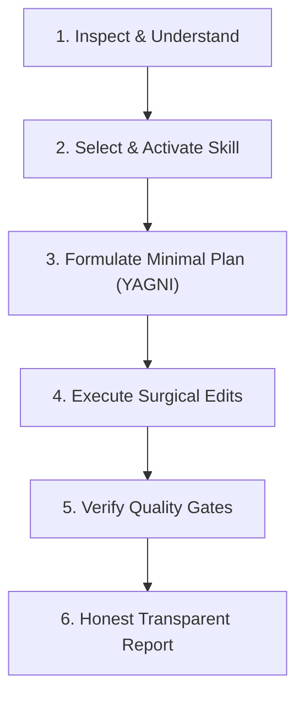

# Agent Workflow & Operating Protocol — Depaskan

Dokumen ini mendefinisikan protokol eksekusi standar bagi AI coding agent (Antigravity, Claude Code, Cursor, dll.) ketika bekerja di repositori Depaskan.

## 1. Siklus Hidup Sesi Rekayasa (Engineering Execution Loop)

Setiap tugas rekayasa harus melalui 6 langkah berurutan:



### Langkah 1: Inspeksi & Pemahaman (Inspect & Understand)
- Baca file kode aktual yang relevan menggunakan alat inspeksi (`view_file`, `grep_search`).
- Periksa status git (`git status`) dan pastikan tidak menimpa perubahan pengguna yang belum di-commit.
- Telusuri aliran data dari antarmuka pengguna hingga penyimpanan lokal / Supabase.

### Langkah 2: Seleksi Keahlian (Progressive Disclosure)
- Berdasarkan domain tugas, baca skill yang sesuai dari `.agents/skills/<skill_name>/SKILL.md`:
  - UI / Komponen / Halaman ➔ `frontend-ui-engineering`
  - Auth / Supabase / API Sync / RLS ➔ `secure-coding-supabase`
  - Pengujian / Verifikasi / Debugging ➔ `testing-quality-gates`
  - Prompt / Pipeline AI / Gemini ➔ `ai-evaluation-provenance`
  - Logika Inti / Kurikulum / LKB Madiun ➔ `depaskan-engineering`
  - Seluruh tugas rekayasa ➔ `disciplined-engineering`

### Langkah 3: Rencana Minimalis Berbasis YAGNI
- Jangan membuat arsitektur berlebihan jika perbaikan sederhana sudah mencukupi.
- Pisahkan perbaikan esensial dari ide tambahan (*scope discipline*).

### Langkah 4: Eksekusi Bedah (Surgical Edits)
- Buat diff sekecil dan sebersih mungkin.
- Pertahankan struktur kode, komentar fungsional, dan gaya arsitektur yang sudah ada.
- Jangan menambahkan dependensi eksternal tanpa verifikasi.

### Langkah 5: Verifikasi Gerbang Kualitas (Quality Gates)
- Jalankan pemeriksaan otomatis:
  ```bash
  # 1. Jalankan seluruh suite pengujian (wajib 97/97 pass)
  npm test

  # 2. Periksa linter (wajib 0 error)
  npm run lint
  ```
- Jika mengubah antarmuka pengguna, periksa 5 status (ideal, empty, loading, error, offline) dan aksesibilitas keyboard.

### Langkah 6: Pelaporan Transparan Wajib (Honest Reporting)
- Akhiri setiap sesi dengan ringkasan transparansi:
  1. Apa yang telah diverifikasi secara aktual.
  2. Apa yang sengaja dilewati dan alasannya.
  3. Fakta terverifikasi vs Asumsi.
  4. Sisa risiko atau batasan.

## 2. Larangan Mutlak (Absolute Invariants)

1. Dilarang menghapus atau menonaktifkan tes yang gagal agar terlihat hijau.
2. Dilarang mengekspos kunci rahasia (API key, Supabase service-role key) ke bundle klien atau log.
3. Dilarang mengubah angka/invarian matematika pada soal yang diadaptasi oleh AI.
4. Dilarang melakukan migrasi database atau pengubahan skema tanpa instruksi eksplisit dari pengguna.
